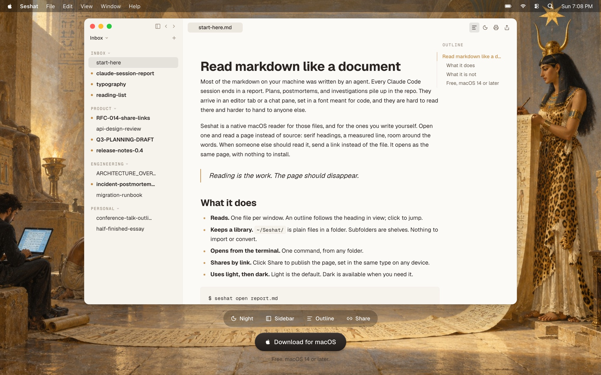

<div align="center">

# Seshat

**A native macOS reader for markdown, with share links that read just as well.**

[seshat.page](https://seshat.page) · Free · macOS 14 or later



</div>

Most of the markdown on a developer's machine is now written by agents: Claude Code reports, plans, postmortems, investigations. It lands in an editor tab, set in a font meant for code, and it is hard to read there and harder to hand to someone else.

Seshat opens those files as pages: serif headings, a measured line, an outline that follows you. When someone else should read it, you send a link instead of the file, and it opens as the same page in any browser.

## Features

- **Reads.** One file per window, with an outline that tracks the heading in view. Click to jump.
- **Keeps a library.** `~/Seshat/` is plain files in a folder. Subfolders become shelves. Nothing to import.
- **Opens from the terminal.** `seshat open report.md` from any folder.
- **Shares by link.** `seshat share notes.md` publishes the page and copies the URL. It renders with the same typography on any device.
- **Shares whole folders.** `seshat share ./docs/` publishes a folder as a small site with a page tree and search.
- **Exports to PDF.** `⌘⇧E` or `seshat export file.md`: smart page breaks, tables that split between rows, a PDF outline from the headings.
- **Tabs, search, drag and drop.** A workspace with tabs, in-document search and a sidebar you can reorganize.
- **Light and dark.** Light by default, dark when you want it.
- **VS Code extension.** *Open in Seshat* from the editor title bar or the explorer.

```sh
$ seshat open report.md
$ seshat share notes.md
https://seshat.page/d/atrium-7c1a · copied
$ seshat export report.md --landscape
```

## How it is built

| Part | Stack |
|---|---|
| macOS app | Swift 6 (strict concurrency), SwiftUI + AppKit, MarkdownUI, FSEvents, Sparkle updates, signed and notarized DMG |
| CLI | POSIX shell shim bundled inside `Seshat.app` |
| Share API | Bun, Hono, Drizzle, Postgres, Zod, Polar for billing |
| Web reader | Next.js, React, react-markdown + remark-gfm, a visual port of the desktop typography |
| Editor integration | VS Code extension |

```
apps/
  macos/    SwiftUI reader (project.yml is the source of truth)
  server/   share API: auth, document CRUD, billing
  web/      public reader at /d/<slug>
  vscode/   "Open in Seshat" extension
cli/        the seshat command
scripts/    release: sign, notarize, DMG
samples/    markdown fixtures
```

## Install

Download the app from [seshat.page](https://seshat.page), move it to `/Applications` and launch it once. Then put the CLI on your PATH:

```sh
"/Applications/Seshat.app/Contents/Resources/seshat" install ~/.local/bin/seshat
seshat open samples/stress.md
```

## Development

Requires macOS 14+, Xcode 16+ and [XcodeGen](https://github.com/yonaskolb/XcodeGen).

```sh
brew install xcodegen
cd apps/macos && xcodegen generate
open Seshat.xcodeproj
```

The `.xcodeproj` is generated, not committed. A signed and notarized release DMG is built with `./scripts/release.sh` (requires an Apple Developer ID).

## Design principles

- **A library, not a dashboard.** Calm, quiet, generous whitespace.
- **The content is the product.** Nothing on screen should compete with the words.
- **Made for developers, does not look like a dev tool.** Books and long-form essays, not IDEs.
- **Opinionated, not configurable.** One reading experience, chosen carefully.
- **Sharing is handing someone a pamphlet.** One command, one link, no sign-up to read.

---

Built by [Keremcan Şeker](https://github.com/keremcanseker). Named after Seshat, the Egyptian goddess of writing and keeper of the House of Books.
