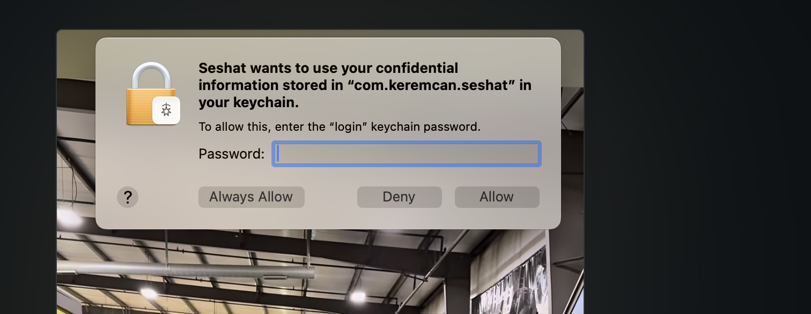

# Seshat — Apple Developer kurulumu

GitHub Actions workflow'u DMG'yi sign + notarize edebilsin diye 7 secret lazım. Olmadan Gatekeeper download'larda "damaged" diyor, kullanıcılar `xattr` workaround'u uygulamak zorunda kalıyor.

Tek seferlik kurulum. Sonrasında her `git tag v* && git push --tags` temiz, çift-tıklanabilir DMG üretir.

> Önkoşul: paid Apple Developer Program (\$99/yıl). Free Apple ID ile Developer ID seçeneği görünmüyor.

---

## Gereken 7 secret

| Secret | Kaynak |
|---|---|
| `DEVELOPER_ID_CERT_B64` | Keychain'den export edilen `.p12`, base64 |
| `DEVELOPER_ID_CERT_PASSWORD` | `.p12` export ederken belirlediğin şifre |
| `DEVELOPER_ID` | `security find-identity` çıktısı |
| `TEAM_ID` | 10 karakterli team ID |
| `NOTARY_API_KEY_B64` | App Store Connect API key (`.p8`), base64 |
| `NOTARY_API_KEY_ID` | API key ID (10 karakter) |
| `NOTARY_API_ISSUER_ID` | API issuer ID (UUID) |

---

## 1. Developer ID Application sertifikası

**Xcode → Settings → Accounts → Manage Certificates → + → Developer ID Application**

Sonra Keychain Access → **login** → **My Certificates** → cert'i bul → **▸** ile private key'in altta nested olduğunu doğrula (yoksa export işe yaramaz, başka makinede yapılmış demektir, yenisini iste).

Cert'e sağ tık → **Export** → **Personal Information Exchange (.p12)** → şifre belirle → `seshat-cert.p12` olarak kaydet.

`DEVELOPER_ID` ve `TEAM_ID` için terminal:

```sh
security find-identity -v -p codesigning
```

Çıktı:
```
1) ABCD... "Developer ID Application: Jane Doe (XYZ123ABCD)"
```
- `DEVELOPER_ID` = tırnak içi (`Developer ID Application: Jane Doe (XYZ123ABCD)`)
- `TEAM_ID` = parantez içi (`XYZ123ABCD`)

---

## 2. Notarization API key

App Store Connect, developer portal değil → <https://appstoreconnect.apple.com>

**Users and Access → Integrations → App Store Connect API → Team Keys → Generate API Key**

- Name: `Seshat Notarization`
- Access: **Developer** (notarize için yeterli)

`AuthKey_XXXXXXXXXX.p8` dosyasını **hemen indir** — Apple sadece bir kere indirme izni veriyor.

Aynı sayfadan al:
- **Key ID** (10 karakter) → `NOTARY_API_KEY_ID`
- **Issuer ID** (sayfa başındaki UUID) → `NOTARY_API_ISSUER_ID`

`.p8`'i 1Password / encrypted note'a kaydet, kaybolursa yenisini oluşturup secret'ları güncellemek gerek.

---

## 3. Base64 + GitHub Secrets

```sh
base64 -i ~/Downloads/seshat-cert.p12 | pbcopy
# → DEVELOPER_ID_CERT_B64

base64 -i ~/Downloads/AuthKey_XXXXXXXXXX.p8 | pbcopy
# → NOTARY_API_KEY_B64
```

Repo → **Settings → Secrets and variables → Actions → New repository secret** ile 7 secret'ı ekle.

Workflow secret'ları conditional okuyor — eksik varsa ad-hoc sign'a düşer (notarize yok). 7'si tamamlanınca bir sonraki tag push notarized DMG üretir.

---

## 4. Release tetikle

```sh
# apps/macos/project.yml içinde MARKETING_VERSION'ı bump et (gerekirse)
git tag v0.1.0
git push origin v0.1.0
```

~5 dakika sonra DMG burada:
```
https://github.com/keremcanseker/seshat/releases/latest/download/Seshat.dmg
```

URL kalıcı — site direkt buna link veriyor.

---

## Tuzaklar

- **`.p12` private key'siz export edilirse** CI'da `no identity found`. Cert'i export edeceğin Mac'te Xcode ile yeniden iste.
- **`.p8` tek seferlik indirilir.** Kaybedersen App Store Connect'te revoke + yeni key.
- **API key role** "Developer" minimum yeterli. "App Manager" tek başına notarize yetkisi vermiyor.
- **Bundle ID** `com.keremcan.seshat`'i App Store Connect'te register **etmeyelim** — notarize için gerekli değil ve ileride hesap geçişi yaparken sorun çıkmaması için.

---

## Lokal doğrulama (opsiyonel)

`.p12`'yi local Keychain'e import ettikten sonra:

```sh
export DEVELOPER_ID="Developer ID Application: Jane Doe (XYZ123ABCD)"
export TEAM_ID="XYZ123ABCD"
bash scripts/release.sh
```

`codesign --verify` çıktıda geçerse cert sağlam. Notarize'ı da end-to-end test etmek istersen:

```sh
xcrun notarytool store-credentials seshat-notary \
    --key ~/Downloads/AuthKey_XXXXXXXXXX.p8 \
    --key-id 2X9ABCDE34 \
    --issuer 69a6de70-...

NOTARY_PROFILE=seshat-notary bash scripts/release.sh
```
